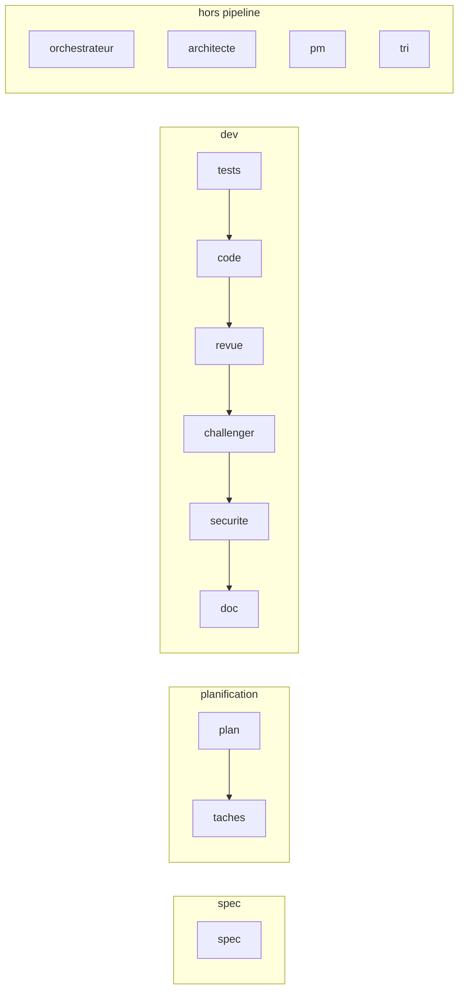

# AI

Dépôt remis à zéro le 14 novembre 2026.

L'historique précédent (labo MLX, dépôt d'outils IA, mcp-fichiers) reste dans `git log`.

## Lancer en local

```sh
cd backend
uv sync
uv run pytest
```

## Déploiement

Le workflow `.github/workflows/deploy.yml` construit les images `ghcr.io/nicolaslallier/ai-portail`, `ai-lanceur` et `ai-execution` (amd64) à chaque push sur `main` et les publie avec le tag `sha-<7 premiers caractères du commit>` ; `latest` n'est posé sur ces mêmes digests qu'une fois les trois analyses Trivy réussies. Le job `deploy` enchaîne alors le redéploiement de la pile `portail` dans Portainer (voir « Redéploiement automatique »).

- **Pile Portainer** : `deploy/portainer-stack.yml`, sur le réseau externe `infra-net`, sans port publié. Variables à renseigner dans la pile : `PORTAIL_DB_PASSWORD` (mot de passe du rôle `portail` de Postgres, sans `@ : / %` ni autre caractère spécial d'URL, ou alors encodé en pourcentage : il est inséré tel quel dans l'URL de la base), `PORTAIL_LITELLM_CLE` (clé LiteLLM), `EXECUTION_DIGEST` (digest `sha256:…` de l'image d'exécution, imposé par le déploiement automatique ; le lanceur ne démarre que cette référence épinglée) et `IMAGE_TAG` (le déploiement automatique l'impose à `sha-<7>` ; `latest` n'est que le défaut quand il est absent, par exemple pour une pile créée à la main).
- **NGINX** : `deploy/nginx/portail.conf` est le vhost `portail.infra.famillelallier.net`. Il se copie dans `Infra/nginx/conf.d/` par une PR séparée sur le dépôt Infra.
- **Authentification** : `oauth2-proxy-portail` de l'Infra (Keycloak, realm `infra`, groupe `portail`). Un utilisateur sans adresse e-mail reçoit un 401 sur tous les appels de l'API.
- **Redéploiement automatique** : le job `deploy` (runner auto-hébergé `ai`) lit `PORTAIL_DB_PASSWORD` et `PORTAIL_LITELLM_CLE` dans OpenBao (secret KV v2 `infra/portail`, lu via l'API à `infra/data/portail` ; `scripts/vault-render-env.sh`), puis `scripts/portainer-stack.sh up` crée la pile `portail` depuis `deploy/portainer-stack.yml` (premier passage) ou la redéploie en retirant l'image `sha-<7>` que ce run vient de construire. Portainer relit le compose sur GitHub `main` ; l'API réécrit toute la liste des variables à chaque déploiement, le script les renvoie donc toutes. Sans effet sur `*.md` et `docs/**`.
  - Environnement GitHub `production` (Settings → Environments), limité à la branche `main`, qui porte les secrets `PORTAINER_API_KEY` (jeton d'accès Portainer) et `BAO_TOKEN` (jeton OpenBao, lecture seule de `infra/data/portail`). Le job `deploy` ne tourne que sur `main`.
  - Le jeton OpenBao est périodique (32 jours) et renouvelé à chaque déploiement ; sans déploiement pendant 32 jours, en créer un nouveau.
  - Variables du dépôt : `PORTAINER_URL` (défaut `https://portainer.infra.famillelallier.net`), `VAULT_URL` (défaut `https://vault.infra.famillelallier.net`), `PORTAINER_ENDPOINT_ID` (obligatoire), `VAULT_SECRET_PATH` (défaut `infra/data/portail`), `INFRA_CA_CERT_PATH` (chemin de la CA de l'Infra dans le runner, défaut `/etc/ai/infra-ca.crt`).
  - Clés du secret KV v2 `infra/portail` (lu via l'API à `infra/data/portail`) : `PORTAIL_DB_PASSWORD`, `PORTAIL_LITELLM_CLE`, `PORTAIL_GITHUB_JETON`, `PORTAIL_GITHUB_APP_ID`, `PORTAIL_GITHUB_APP_CLE`, `PORTAIL_LANCEUR_SECRET`, `PORTAIL_NTFY_JETON`.
  - Aucun workflow du dépôt ne doit avoir de déclencheur `pull_request`, `pull_request_target`, `issue_comment` ou `workflow_run` pouvant atteindre le label self-hosted `ai` : une PR de fork peut modifier `ci.yml` elle-même. Le dépôt est public : exiger l'approbation pour tous les collaborateurs externes (Settings → Actions → General → Fork pull request workflows from outside collaborators), et le runner `ai` doit être éphémère (conteneur neuf par job, aucun volume de travail persistant).
  - Le déploiement rejoue la CI (`ci.yml`, appelée par `deploy.yml`) et ne construit rien si elle échoue. Elle comprend les audits de dépendances (`pip-audit`, `npm audit`, `cargo audit`), la recherche de secrets (`gitleaks`) et, après chaque construction, l'analyse Trivy des images (CRITICAL/HIGH corrigeables). Actions et images de base sont épinglées par SHA ou digest ; Renovate propose les mises à jour le samedi (`renovate.json`).
  - Étapes manuelles (réglages GitHub, hors dépôt) :
    - protéger `main` : exiger les contrôles `backend`, `frontend`, `lanceur` et `securite` avant fusion ;
    - installer l'application Renovate sur le dépôt.
    - remplacer `PORTAIL_LITELLM_CLE` dans OpenBao par une clé LiteLLM limitée aux modèles de `modeles_permis` (`agents.yaml`), jamais la clé maîtresse.

## Agents et pipelines

Schéma généré depuis `agents.yaml` ; après un changement, lancer `cd backend && uv run python -m portail.schema_pipelines`.

La page Bureau (`/bureau`) montre en direct l'état de chaque agent, rangé comme ce schéma.

<!-- schema-pipelines:debut -->

<!-- schema-pipelines:fin -->

## Monitoring

- **`/metrics`** : format Prometheus, lu par Prometheus sur `infra-net` (job `portail`) ; le frontal NGINX répond 404 (`location ^~ /metrics` de `deploy/nginx/portail.conf`).
- **Tableaux de bord et alertes** : `deploy/grafana/` (`portail-sante`, `portail-boucle-dev`, `portail-agents`, `portail-lanceur`, et `alertes-portail.yml`), recopiés par la PR Infra du lot G (`deploy/infra/README.md`). `backend/tests/test_grafana.py` vérifie que chaque métrique citée existe.
- **Table `appel_llm`** : une ligne par appel au modèle (agent, modèle, lieu, issue, jetons, durée), écrite par `ClientLLM`, sans aucun contenu.
- **Journaux JSON** : un objet par ligne, avec les champs `pipeline`, `etape`, `tache`, `conversation`, `agent` et `mission` quand ils existent. Recherche Loki : `{container=~"portail-portail.*"} | json | mission="<id>"`.
- **Aucun contenu** dans une métrique, une étiquette, un journal, une alerte ou un panneau : seulement identifiants, noms, compteurs, durées et codes.

## Sécurité

Le dépôt est public : rien de secret n'y entre, tout passe par OpenBao.

- **Ce que la CI bloque** : audits de dépendances (`pip-audit`, `npm audit`, `cargo audit`), secrets (`gitleaks`) et images avec une faille CRITICAL/HIGH corrigeable (Trivy, sur les trois images). `latest` n'est posé qu'après les trois analyses ; avant, une image ne porte que `sha-<7>`.
- **Épinglage** : actions et images de base par SHA ou digest, mises à jour proposées par Renovate. Un projet nomme une image par `nom:tag` ; le lanceur la résout vers le digest de `LANCEUR_IMAGES` / `LANCEUR_IMAGES_SERVICES` et refuse le reste. Le portail et le lanceur tournent avec `cap_drop: ALL`, `read_only` et `no-new-privileges` (pile Portainer). Les conteneurs d'exécution et de service que le lanceur crée ne reçoivent que `cap_drop: ALL` et `no-new-privileges` (les services regagnent cinq capacités pour démarrer, p. ex. postgres) ; leur `/travail` reste en écriture et seul `/travail/.git` est en lecture seule.
- **Modèles** : `modeles_permis` (`agents.yaml`) liste les seuls modèles admis, `modele_si_meme` compris ; la clé LiteLLM du portail est limitée à cette liste.
- **Journal d'audit** : table `audit` (auteur, action, objet, identifiant, date), lisible par `GET /api/audit` (`limite`, `avant`), sans écriture par l'API. Hors développement local, l'auteur est l'adresse e-mail transmise par oauth2-proxy.
- **Aucun contenu dans les journaux ni les notifications** : ni message, ni document, ni sortie de commande, ni secret. Les erreurs passent par `portail.journal.erreur` (classe de l'exception et pile, jamais son message) ; ntfy ne porte que des libellés génériques, le résumé du matin envoie seulement « Résumé prêt » et le lien.

### Étapes manuelles (hors dépôt)

1. Protéger `main` : exiger les contrôles `backend`, `frontend`, `lanceur` et `securite` avant fusion.
2. Installer l'application Renovate sur le dépôt.
3. Émettre la clé LiteLLM limitée aux modèles de `modeles_permis` et la ranger dans OpenBao (`PORTAIL_LITELLM_CLE`), jamais la clé maîtresse.
4. Vérifier que la base `portail` et le volume `portail-donnees-2` sont dans les sauvegardes chiffrées de l'Infra, sinon les y ajouter.
5. Ouvrir la PR Infra décrite dans `deploy/infra/README.md` (règle Alloy, vhost, vérifications) ; le détail y reste.
6. Décider si le dépôt devient privé (question ouverte de la spec).
7. Épingler MinIO : `minio/minio:latest` est resté sans digest dans `deploy/portainer-stack.yml` (Docker Hub refuse l'accès anonyme à ce dépôt). Choisir un tag `RELEASE` daté, relever son digest avec un accès authentifié, le remplacer, puis nommer ce tag dans les projets.
8. Lancer `actionlint` sur `.github/workflows` avant la fusion : il n'a pas pu tourner pendant le lot, et une erreur dans `deploy.yml` ne se verrait qu'après la fusion dans `main`.
9. Au premier déploiement, vérifier que le lanceur durci (`cap_drop: ALL`, `read_only`) répond et démarre une exécution, et que Trivy lit bien GHCR.
10. Dans Settings > Actions > General du dépôt, exiger l'approbation des workflows pour TOUS les contributeurs externes (« Require approval for all outside collaborators » ; le réglage par défaut ne couvre que les nouveaux contributeurs), et relire le diff de `.github/` avant d'approuver.
11. Rendre le runner auto-hébergé `ai` éphémère (un job, puis il est recréé). Le dépôt est public : une PR de fork peut AJOUTER son propre workflow `on: pull_request` avec `runs-on: [self-hosted, ai]`, donc le contenu des workflows de `main` ne protège pas le runner ; seuls l'approbation de tout fork et l'éphémérité le font.

### Jeton GitHub (lecture seule)

Le portail lit les dépôts GitHub avec un jeton à grain fin (fine-grained), limité aux dépôts choisis, avec les permissions **Contents : Read** et **Metadata : Read** seulement, et sans aucune permission d'écriture. Il est rangé dans OpenBao (clé `PORTAIL_GITHUB_JETON` du secret `infra/portail`), que le déploiement automatique recopie dans la pile, et ne va jamais dans le dépôt. Les données du portail vivent dans le volume `portail-donnees-2`, monté sur `/donnees` (l'ancien `portail-donnees` appartient à l'ancien uid et reste orphelin : à supprimer à la main).

### GitHub App du portail (boucle de dev)

La boucle de dev pousse des branches et ouvre des PR par une GitHub App, jamais par le jeton en lecture seule ci-dessus.

1. Créer l'App (Settings → Developer settings → GitHub Apps) avec les permissions **Contents : Read & write**, **Pull requests : Read & write**, **Metadata : Read**, et **sans** Administration ni webhook. Générer une clé privée (`cle.pem`).
2. L'installer sur les seuls dépôts voulus. La branche par défaut de chaque dépôt doit être **protégée** : sinon le portail refuse de lancer le pipeline `dev`.
3. Ranger dans OpenBao, secret `infra/portail` : `PORTAIL_GITHUB_APP_ID` (l'id de l'App), `PORTAIL_GITHUB_APP_CLE` (le PEM en **base64 sur une seule ligne** : `base64 -w0 cle.pem` sous Linux, `base64 -i cle.pem | tr -d '\n'` sous macOS) et `PORTAIL_LANCEUR_SECRET` (`openssl rand -hex 32`, 32 caractères au moins).
4. Le lanceur (service `lanceur`, seul à monter `/var/run/docker.sock`) démarre les commandes des agents dans des conteneurs jetables de l'image `ai-execution`, sur le réseau `run-net` et le proxy `run-egress` de l'Infra (PR « run-net » du dépôt Infra, à déployer avant ce dépôt). Hôte Docker en version **26 ou plus** (montage de sous-chemin de volume).
5. **Prérequis bloquant :** `PORTAIL_LANCEUR_SECRET` (32 caractères au moins) doit exister dans OpenBao `infra/portail` **avant** la fusion et le déploiement de ce dépôt. Sinon le déploiement échoue : `scripts/vault-render-env.sh` s'arrête si la clé manque et le lanceur quitte (redémarrage en boucle) avec un secret de moins de 32 caractères. `PORTAIL_GITHUB_APP_ID` et `PORTAIL_GITHUB_APP_CLE` sont facultatives : absentes, le script les écrit vides avec un avertissement, et le portail garde son ordonnanceur éteint ; le reste fonctionne comme avant.

### Reprise sur commentaires et ntfy

Quand Nicolas commente la PR d'une tâche *En revue*, le portail reprend la boucle de dev sur la même branche et la même PR, puis notifie par ntfy.

- Le jeton ntfy s'obtient avec `make ntfy-provision app=portail` dans l'Infra et se range dans OpenBao, secret `infra/portail`, clé `PORTAIL_NTFY_JETON`, clé facultative : absente, `scripts/vault-render-env.sh` l'écrit vide avec un avertissement et le portail n'envoie pas de notification.
- Seuls les commentaires de `PORTAIL_GITHUB_PROPRIETAIRE` déclenchent une reprise.
- Une revue part tout de suite ; des commentaires isolés partent 10 minutes après le dernier.
- Recommenter relance une reprise échouée.

Les projets nomment les images par `nom:tag` (`ghcr.io/nicolaslallier/ai-execution:latest`, `postgres:16-alpine`, `pgvector/pgvector:pg16`) : le lanceur démarre la référence épinglée par digest de `LANCEUR_IMAGES` / `LANCEUR_IMAGES_SERVICES`, et refuse tout autre tag ou digest. Pour MinIO, il faudra nommer le tag daté retenu dans la pile (pas `latest`) dès qu'il y sera épinglé.

Exemple de configuration d'exécution pour EA (l'image doit figurer dans `LANCEUR_IMAGES`). Les commandes partent de la racine du dépôt, et `{fichiers}` y est remplacé par des chemins relatifs à cette racine (`backend/tests/test_x.py`) : ne pas faire `cd backend` avant `{fichiers}`. Les motifs de `chemins_tests` désignent des fichiers : `backend/tests/**`, pas `backend/tests`.

```yaml
image: ghcr.io/nicolaslallier/ai-execution:latest
chemins_tests: ["backend/tests/**"]
commandes:
  installer: uv sync --project backend
  tests: uv run --project backend pytest -q backend/tests
  tests_cibles: uv run --project backend pytest -q {fichiers}
  lint: uv run --project backend ruff check backend
services:
  - nom: db
    image: pgvector/pgvector:pg16
    env: {POSTGRES_PASSWORD: test}
```

La commande `tests_cibles` doit sortir en non-zéro seulement quand des tests échouent : à la vérification « rouge », les codes 3 et 4 (erreur interne ou d'usage de pytest) bloquent la tâche (« commande de tests invalide ») et le code 5 (aucun test collecté) la bloque comme « aucun test écrit ». Tout autre code non nul compte comme un vrai rouge (pytest 1 et 2, jest et vitest 1, cargo 101).
